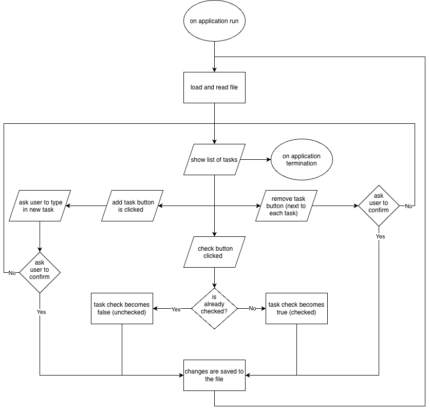

# Simple TODO List
A Basic and Simple TODO List written in Java

## The Problem
The todo list tracker I use keeps on trying to charge me money, and locks certain features behind a paywall.

## How It Works
It will work with basic JDK library GUI to interact with the user, and store data in a file (locally)

## Future Plans / Roadmap
- [ ] Users and Accounts
- [ ] Cloud Sync
- [ ] Web Versions or Other Platforms

## Tech Stack
Languages: Java
Libraries: Standard JDK Libraries (for basic GUI, File Manipulation)
External Tools: IntelliJ IDEA IDE (and included plugins)

## Setup
will be added in the future (stay tuned)

## Usage
will be added in the future (stay tuned)
