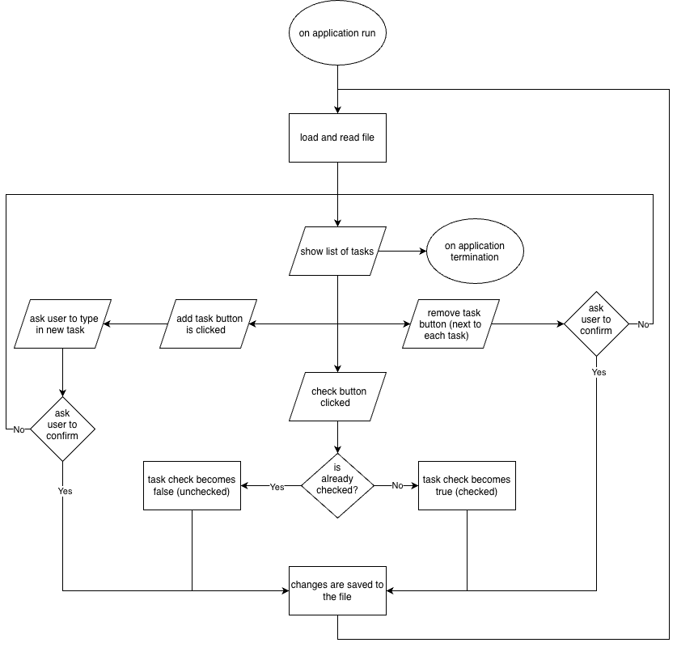

# Simple TODO List
A Basic and Simple TODO List written in Java

## The Problem
The todo list tracker I use keeps on trying to charge me money, and locks certain features behind a paywall.

## How It Works
It will work with basic JDK library GUI to interact with the user, and store data in a file (locally)\


## Future Plans / Roadmap
- [ ] Users and Accounts
- [ ] Cloud Sync
- [ ] Web Versions or Other Platforms\


## Tech Stack
Languages: Java\
Libraries: Standard JDK Libraries (for basic GUI, File Manipulation)\
External Tools: IntelliJ IDEA IDE (and included plugins)

## Setup
### Prerequisites
- Git to clone the repository
    - Run `git -v` (or `git --version`) to see if Git is already installed. If not, follow the guide below to install it.
- [Git Installation Guide](https://git-scm.com/book/en/v2/Getting-Started-Installing-Git)
- JDK 17 or higher (for compiling and running the program)
    - Run `java -version` and `javac -version` to see if the JDK is already installed. If not, follow the guide below to install it.
    ```bash
    java -version
    javac -version
    ```
- [JDK Installation Guide](https://www.oracle.com/java/technologies/javase-jdk17-downloads.html)
- You might also want to do a reinstallation if there is a version mismatch between the two commands, or if either version is less than 17.

### Installing
1. Clone the repository
   ```bash
   git clone https://github.com/jasperkwon08/simple_todo_list.git
   ```
2. Navigate into the project folder
   ```bash
   cd simple_todo_list
   ```
3. Compile the Java files
   ```bash
   javac src/*.java
   ```
4. Run the application
   ```bash
   java -cp src TodoApp
   ```


## Usage
Run the app from the project root first:
```bash
java -cp src TodoApp
```

### Normal Usage Example
- Input: Enter "john" at the username prompt, click "ok", push "Add Task" button, type "task1", click "ok", confirm by clicking "ok" again, and toggle it as completed.
- Output (in newly created text file under task_files folder, "task_files/john_tasks.txt"):
  ```text
  1|task1
  ```

### Default Fallback
- Input: Click "Cancel" (or leave it blank and click "ok") at the startup username prompt, push "Add Task" button, type "task1", click "ok", and confirm by clicking "ok" again.
- Output (in newly created text file under task_files folder, "task_files/default_tasks.txt"):
  ```text
  0|task1
  ```

### Empty List Cleanup
- Input: Click "Remove" next to the last remaining task for "john" and confirm by clicking "Yes".
- Output: "task_files/john_tasks.txt" is automatically deleted (and the "task_files" folder is deleted too if no other user files remain).
  
## Demo
will be added in the future (stay tuned)